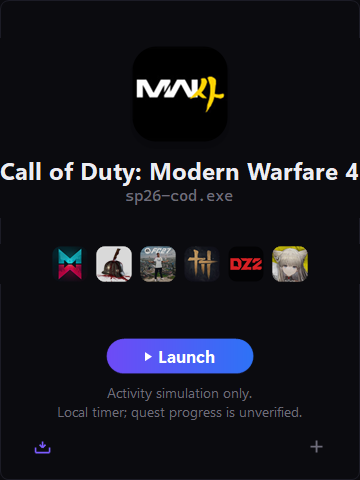

<div align="center">


# Discord Quest Launcher

**A lightweight, standalone game simulation & Discord Rich Presence companion for Windows**

*Complete Discord Quests effortlessly without downloading dozens of gigabytes of game files.*

<p>
  
  
  
  
  
</p>

---

<p>
  <a href="#-about-discord-quest-launcher">About</a> •
  <a href="#-key-features">Features</a> •
  <a href="#-visual-tour">Visual Tour</a> •
  <a href="#-quick-start--usage">Quick Start</a> •
  <a href="#-how-it-works">How It Works</a> •
  <a href="#-building-from-source">Building</a> •
  <a href="#-configuration--storage">Configuration</a> •
  <a href="#-disclaimer--notes">Disclaimer</a>
</p>

<picture>
  
</picture>

</div>

---

## 🎮 About Discord Quest Launcher

Discord regularly hosts in-app **Quests** rewarding users with badges, avatar decorations, and in-game collectibles for playing featured titles (such as *Call of Duty*, *Dragon's Dogma II*, *Where Winds Meet*, *Apex Legends*, or *Valheim*). However, downloading 50GB–150GB just to fulfill a 15-minute quest is impractical for players with metered connections, limited SSD storage, or low-spec hardware.

**Discord Quest Launcher** is a self-contained, native Windows desktop application engineered to simulate game presence directly to Discord without downloading full game installations:

- 🚀 **Zero Storage Burden**: Simulate game sessions without downloading massive game packages.
- 🔌 **Native Discord IPC Handshake**: Direct communication with Discord's desktop client via local named pipes (`\\.\pipe\discord-ipc-0` through `9`).
- 🪟 **Dual-Layer Process Detection**: Spawns isolated, lightweight dummy processes under `%TEMP%\DiscordDummyTools` to satisfy Discord's active process scanning engine.
- ⏱️ **Built-in Session Stopwatch**: Real-time timer tracking session duration and milestone qualification.
- 🎨 **Discord-Themed Modern UI**: Dark-mode frameless interface with DWM rounded corners, quick-select game carousel, search filtering, and system tray minimization.
- 🛡️ **Self-Contained & Privacy-First**: 100% local, zero telemetry, no login credentials or Discord tokens required.

---

## ✨ Key Features

<table>
  <tr>
    <td width="50%">
      <h3>🔄 Dual-Layer Simulation</h3>
      <p>Simultaneously issues Discord Rich Presence <code>SET_ACTIVITY</code> packets and spawns a lightweight matching executable process so both RPC and client process detection register the game.</p>
    </td>
    <td width="50%">
      <h3>🎯 Instant Game Switcher</h3>
      <p>Seamlessly switch between popular Discord Quest titles using a visual icon strip with cached high-resolution art pulled directly from Discord's CDN.</p>
    </td>
  </tr>
  <tr>
    <td width="50%">
      <h3>🔍 Deep Catalog &amp; Search</h3>
      <p>Built-in catalog of verified quest games with instant fuzzy search filtering. Add any custom title on the fly by providing its Discord Application ID and process name.</p>
    </td>
    <td width="50%">
      <h3>⏱️ Precise Session Timers</h3>
      <p>Live session stopwatch integrated into the interactive Launch/Stop pill button, recording play duration and tracking milestones locally.</p>
    </td>
  </tr>
  <tr>
    <td width="50%">
      <h3>📥 Background Tray Minimization</h3>
      <p>Minimize seamlessly to the Windows notification tray during simulations. Right-click context menu enables quick control, restoration, and clean shutdown.</p>
    </td>
    <td width="50%">
      <h3>🧹 Guaranteed Process Hygiene</h3>
      <p>Automatic lifecycle management ensures helper processes and temporary executables under <code>%TEMP%\DiscordDummyTools</code> are cleanly terminated on exit.</p>
    </td>
  </tr>
</table>

---

## 📸 Visual Tour

### 1. Main Dashboard &amp; Quick Switcher
Select your desired game from the quick-switch bar or search bar. High-resolution game banners, application IDs, and detected executable targets are displayed automatically.

<p align="center">
  
</p>

- **Hero Banner**: Displays current title, Discord CDN icon, and target executable (e.g. `sp26-cod.exe`, `roblox.exe`, `dd2.exe`).
- **Switcher Carousel**: Quick access to recent and qualified quest titles.
- **Pill Action Button**: Single-click `▶ Launch` transitions into `⏹ Stop` with live session timer.
- **Taskbar & Tray Integration**: Runs unobtrusively in the background while you work or browse.

---

## 🚀 Quick Start &amp; Usage

### Running the Application

Simply launch the precompiled executable:

```powershell
.\GameLauncher.exe
```

### Step-by-Step Workflow

1. **Launch Discord**: Ensure the official Discord desktop client is running and logged in.
2. **Open Launcher**: Start `GameLauncher.exe`.
3. **Pick a Game**: Choose a game from the horizontal icon bar or click the search box to find a qualified quest title.
4. **Start Simulation**: Click **`▶ Launch`**. The button changes to an active timer and Discord will display your Rich Presence activity.
5. **Meet Quest Time**: Let the launcher run until your Discord Quest requirements are fulfilled (commonly 15 minutes).
6. **Stop & Finish**: Click **`⏹ Stop`** to terminate the simulated session and clean up background processes. Check your Discord Quests tab to claim your reward!

---

## ⚙️ How It Works

Discord validates gameplay through two distinct mechanisms depending on the game and quest configuration:

```
┌──────────────────────────────────────────────────────────┐
│                   Discord Quest Launcher                 │
└──────────────┬────────────────────────────┬──────────────┘
               │                            │
  (1) IPC Named Pipe Handshake     (2) Helper Process Execution
               │                            │
               ▼                            ▼
┌──────────────────────────────┐ ┌───────────────────────────┐
│ \\.\pipe\discord-ipc-0..9    │ │ %TEMP%\DiscordDummyTools\ │
│ SET_ACTIVITY (App ID & Hash) │ │ <game>.exe (Dummy Window) │
└──────────────┬───────────────┘ └──────────┬────────────────┘
               │                            │
               └──────────────┬─────────────┘
                              ▼
               ┌─────────────────────────────┐
               │    Discord Desktop Client   │
               │   (Registers Game Activity) │
               └─────────────────────────────┘
```

1. **Named Pipe RPC**: Connects to the local `\\.\pipe\discord-ipc-0` through `9` socket and sends Discord Rich Presence `SET_ACTIVITY` payloads containing the game's client ID and icon assets.
2. **Dummy Process Emulation**: Automatically clones a minimal, harmless dummy host binary to `%TEMP%\DiscordDummyTools\<target-exe>.exe` and launches it with matching window titles to satisfy Discord's local process scanner.

---

## 🛠️ Building from Source

The project is built entirely in C# targeting the native Windows .NET Framework using PowerShell CodeDOM compilation. No external build toolchains, MSBuild installations, or NuGet packages are required.

### Prerequisites

- **Windows 10** or **Windows 11**
- **Windows PowerShell 5.1** (`powershell.exe`)
  > [!NOTE]
  > Use Windows PowerShell 5.1 (`powershell.exe`). PowerShell Core (`pwsh`) is not supported by the CodeDOM build script.

### Build Steps

1. **Clone the repository:**
   ```powershell
   git clone https://github.com/projectGloria/FakeGameLauncher.git
   cd FakeGameLauncher
   ```

2. **Compile the executable:**
   ```powershell
   powershell.exe -NoProfile -ExecutionPolicy Bypass -File .\Build-Launcher.ps1
   ```
   This compiles `GameLauncher.cs` and embeds `assets\AppIcon.ico` into an atomic staging binary before safely replacing `GameLauncher.exe`.

3. **Run Regression Tests:**
   Run the test harness to verify CodeDOM compilation, process lifecycle management, and RPC mock isolation:
   ```powershell
   powershell.exe -NoProfile -STA -File .\tests\Run-Tests.ps1
   ```

4. **Launch the build:**
   ```powershell
   .\GameLauncher.exe
   ```

---

## 📁 Configuration &amp; Storage

The application isolates all persistent state and cached metadata under `%LOCALAPPDATA%\DiscordQuestLauncher`:

| File | Purpose |
|---|---|
| `qualified_games.json` | Curated list of verified Discord Quest games with App IDs and assets. |
| `games_cache.json` | Local game catalog cache retrieved from Discord. |
| `custom_games.json` | User-added custom game definitions. |
| `last_simulated.json` | State persistence remembering the most recently simulated game. |
| `launcher.log` | Diagnostic log file for debugging and IPC troubleshooting. |

---

## 🎨 Design Philosophy

- **Native Windows Ergonomics**: Frameless design with custom title bar controls, custom GDI+ anti-aliased typography rendering, and smooth mouse drag-and-drop.
- **Discord Aesthetic**: Custom dark palette (`#1E1F22`, `#2B2D31`, `#5865F2`) matching Discord's modern client styling.
- **High-DPI Icon Rendering**: Multi-layer icon cache fetching high-resolution 1024px Discord CDN icons and rendering crisp downscaled representations.

---

## ⚠️ Disclaimer &amp; Notes

> [!IMPORTANT]
> **Rich Presence Display vs. Quest Credit**:
> Rich Presence acknowledgements confirm activity display only. Local session timers and `qualified_games.json` do not independently verify Discord quest credit. Always inspect your official Discord client Quest tab to confirm quest progress and claim awards.

> [!NOTE]
> This tool is intended for personal utility and educational research into Discord's IPC protocol and game detection mechanisms. It is not affiliated with, maintained by, or endorsed by Discord Inc.

---

## 📜 License

Distributed under the **[MIT License](LICENSE)**. See `LICENSE` for details.
